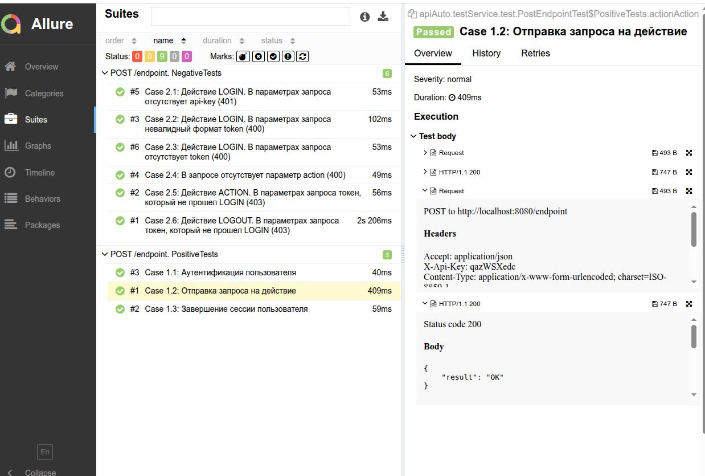

# API-тесты (RestAssured + JUnit 5 + WireMock)

## Используемые технологии

| Технология                | Версия  |
|:--------------------------|:--------|
| **Java**                  | 17      |
| **RestAssured**           | 5.3.0   |
| **JUnit 5**               | 5.10.0  |
| **JSON Schema Validator** | 5.3.0   |
| **Allure Framework**      | 2.25.0  |
| **WireMock**              | 3.9.1   |
| **Maven**                 | 3.x     |

---

## Структура проекта

    src/test/java/apiAuto/
    ├── common/                      # Общие вещи для любых тестов (не привязаны к эндпоинту)
    │   ├── config/                  # Общие конфиги
    │   ├── constants/               # Общие константы
    │   └── helpers/                 # Общие хелперы
    │
    └── testService/                 # Всё, что относится к тестируемому сервису
        ├── postEndpoint/            # Эндпоинт POST /endpoint
        │   ├── config/              # Конфиги эндпоинта
        │   ├── constants/           # Константы эндпоинта
        │   └── helpers/             # Хелперы эндпоинта
        │
        └── test/                    # Тесты

    src/test/resources/
    ├── config/local/app.properties  # Локальные настройки: base.url, api.key, таймауты
    ├── schemas/                     # JSON-схемы для проверки ответов
    │   ├── errorSchema.json         # Схема неуспешных ответов  
    │   └── successSchema.json       # Схема успешных ответов
    └── allure.properties            # Настройки Allure

---

## Что сделать перед запуском:

1. Создать локальный конфиг `src/test/resources/config/local/app.properties` и скопировать туда данные из шаблона `src/test/resources/config/local/app.properties.example` (ключи заполнить самостоятельно актуальными)
2. В локальном конфиге заполнить актуальные значения `api.key` и `api.secret`.
3. Jar тестируемого сервиса положить в `internal-service-tests/app`.

---

## Как запустить

**Запуск тестов + генерация отчета**

    mvn clean test; mvn allure:serve

**Важно:**
- WireMock и тестируемое приложение запускаются автоматически во время выполнения тестов, поэтому порты `8080` и `8888` должны быть свободны.
- Стабы для запросов так же устанавливаются автоматически.

---

## Пример отчёта:

---

## Позитивные тесты

| № кейса | Метод | Название теста | Статус код |
|---------|-------|----------------|------------|
| Case 1.1 | POST /endpoint | Аутентификация пользователя (LOGIN) | 200 |
| Case 1.2 | POST /endpoint | Отправка запроса на действие (ACTION) | 200 |
| Case 1.3 | POST /endpoint | Завершение сессии пользователя (LOGOUT) | 200 |

## Негативные тесты

| № кейса | Метод | Название теста | Статус код |
|---------|-------|----------------|------------|
| Case 2.1 | POST /endpoint | Отсутствует api-key | 401 |
| Case 2.2 | POST /endpoint | Невалидный формат token | 400 |
| Case 2.3 | POST /endpoint | Отсутствует параметр token | 400 |
| Case 2.4 | POST /endpoint | Отсутствует параметр action | 400 |
| Case 2.5 | POST /endpoint | ACTION с токеном, не прошедшим LOGIN | 403 |
| Case 2.6 | POST /endpoint | LOGOUT с токеном, не прошедшим LOGIN | 403 |